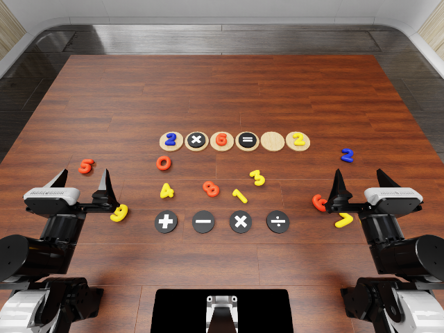

# 待标注图片

## 先用这组图片试画

已提供 `solve_equation_round13_000000/`，来自原绘制界面验证使用的历史观察，三个 PNG 均保持原始文件字节。

1. 下载或 Clone 整个仓库，打开根目录的 `sketch.html`。
2. 导入上图对应的本地文件 `samples/solve_equation_round13_000000/current_cam_head.png`。
3. 观察编号填 `000000`，相机选 `head`，手臂选 `right`，点含义选“夹爪中心经过的位置”。高度先留空。
4. 按 [task.txt](solve_equation_round13_000000/task.txt) 试画右夹爪接近黄色数字 1、抓取、搬运到算式空垫、释放及撤离的路径。
5. 导出 JSON，保存为 `annotations/solve_equation_round13_head_000000.json`，然后提交回仓库。

同目录另有 `current_cam_left_wrist.png`、`current_cam_right_wrist.png` 两张原图。导入哪个视角，就选择对应相机。一次导出对应一张图片和一只手臂。

该图片是一份历史快照，可用于离线练习；后续运行 DS 时应另外核对当前观察。`manifest.json` 记录观察编号、来源、分辨率和每张原图的 SHA256。

## 添加其他任务

按任务和实验场次新建目录，放入未经修改的原始相机 PNG 和 `task.txt`。

`task.txt` 应填写：任务目标、场次标识、观察编号、相机、操作手臂、希望绘制夹爪路径还是物体路径，以及需要标注的动作阶段。

没有完整任务说明时，不应仅凭图片猜测目标。不同实验的 `000000` 不是同一观察，请在目录名中区分场次。

画完将导出的 JSON 移入仓库根目录的 `annotations/`，文件名包含任务、场次、相机和观察编号，然后提交。
