# solve_equation：seed 11，第 13 轮完整单次流程

这里包含从初始场景到本轮原生任务结束的全部已保存图像：6 个原始观察时点 × 3 个相机，共 18 张原始 PNG；另将全部 15 段原始执行视频逐帧导出为 240 张 PNG（三个相机各 80 帧）。共 258 张图片，没有跳帧抽样。对应 79 个实际原生动作；首次未执行动作的校验错误也完整保留。

这是 seed 11 的第 13 轮完整单次轨迹，并非把同一个 seed 的 20 次重复尝试混成一次流程。

原生任务指令：选择正确的缺失数字或运算符放到垫子上，完成算式，然后将机械臂复位。本场景可见 2 × 6 = □ 2，本轮操作搬运黄色数字 1。

## 按顺序看完整流程

下表阶段说明依据实际控制代码、原生动作计数和图像整理。点击图片可看原图；所有原始 PNG 均保留文件字节。

| 观察编号 | 累计原生动作 | 阶段 | head | left_wrist | right_wrist |
| --- | ---: | --- | --- | --- | --- |
| 000000 | 0 | 初始场景 |  | 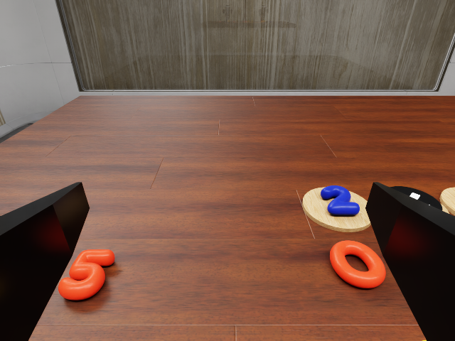 | 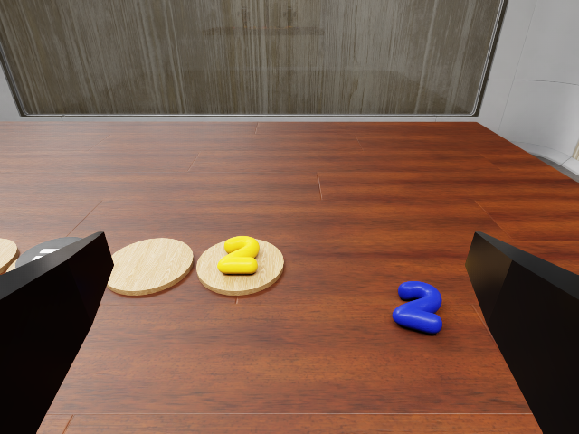 |
| 000001 | 0 | 首次提交被导入校验拒绝，未执行动作 | 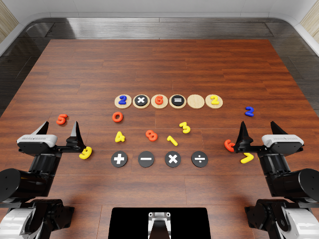 |  |  |
| 000002 | 21 | 接近目标、下降并闭爪 | 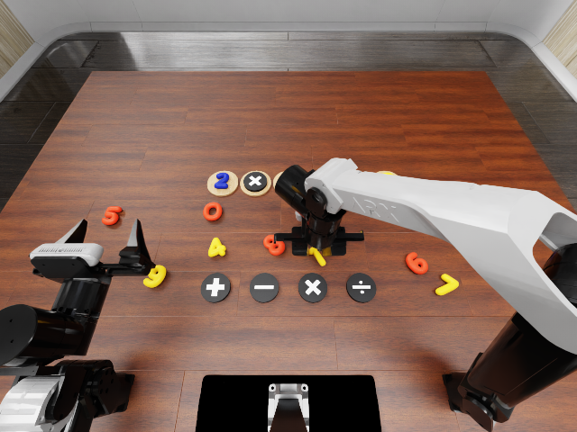 | 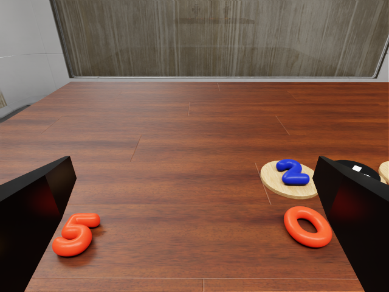 |  |
| 000003 | 50 | 分步抬升并搬运至放置区 | 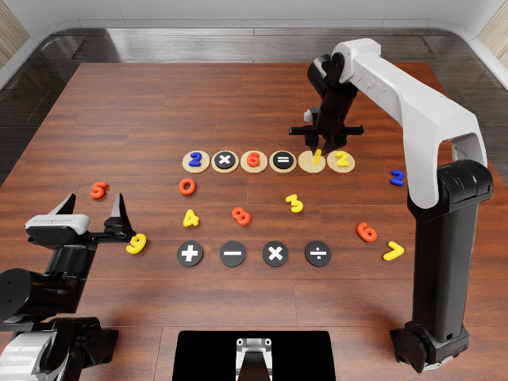 |  |  |
| 000004 | 72 | 下降、开爪释放、撤离与停靠 | 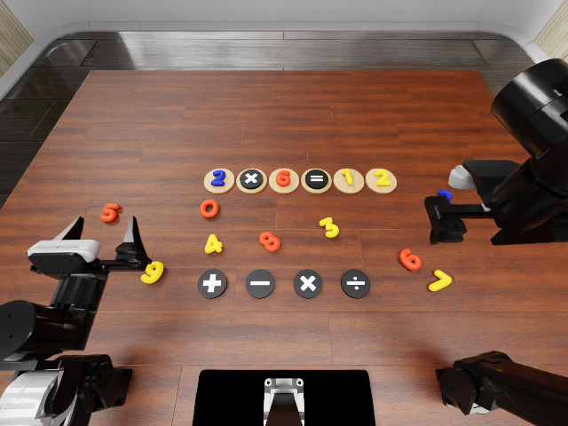 | 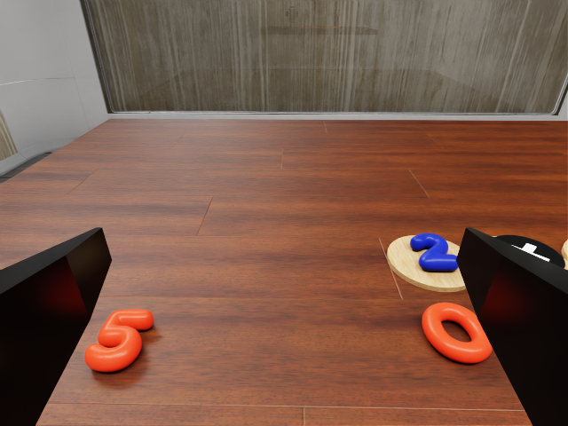 | 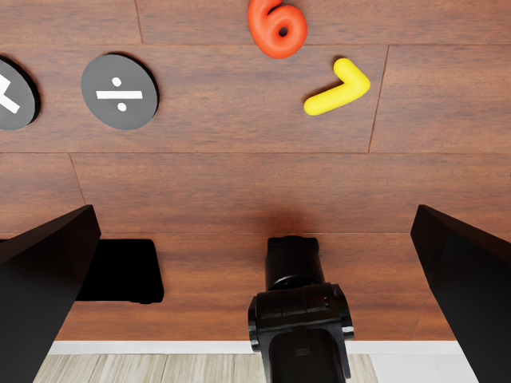 |
| 000005 | 79 | 启动机械臂返回，原生任务判定成功并终止 | 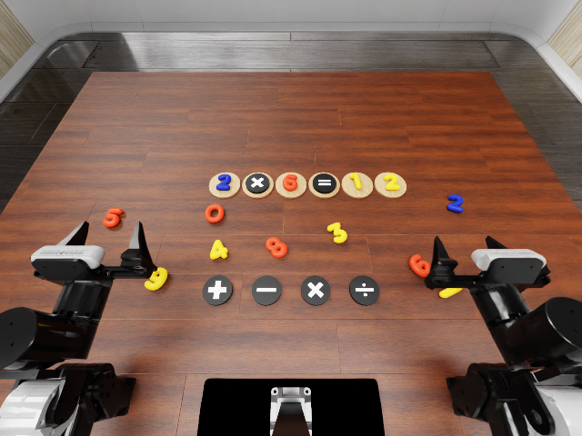 |  | 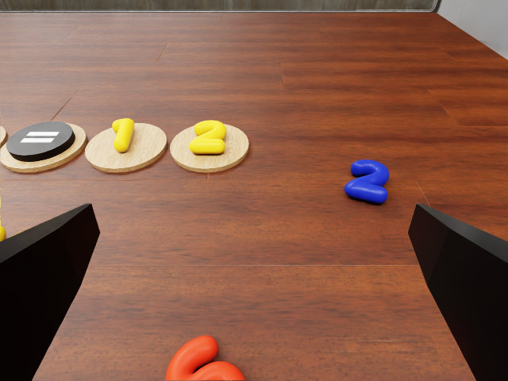 |

## 查看每一个中间帧

进入 [全部逐帧图片索引](frames/README.md)。每行对应一个视频帧位置，列出三个相机的图片链接；文件名包含提交编号与段内帧号，按编号排序即可。`videos/` 另存了未经改动的全部 15 段原始视频。

逐帧 PNG 来自已压缩的执行视频，与原始观察 PNG 分开保存；它们不是额外采集的高保真原始观察。阶段内帧号是视频顺序，不宣称拥有独立的逐帧机器人状态或标定。

## 在本地绘制

1. 下载完整仓库，在浏览器打开根目录 `sketch.html`。
2. 先看完整流程，再选择要给 DS 指导的阶段图，例如 `observations/000002/current_cam_head.png`。
3. 导入这张图片，观察编号填 `000002`，相机选 `head`，手臂选 `right`，点含义选“夹爪中心经过的位置”。不清楚世界高度时留空。
4. 画当前阶段接下来的路径，设置对应开合爪事件，导出 JSON。每张图单独导出，建议保存为 `annotations/solve_equation_seed11_round13_head_000002.json`。
5. 若使用视频中间帧，观察编号请填索引中的 `video_...` 标注 ID；相机仍按导入图片选择。它不是原生观察编号，只能作为图像绑定的二维指导。

绘制页面的夹爪与高度选项只作用于随后新增的点。完整流程图片不要求你照抄已经发生的动作；请明确每张图上要指导的后续阶段。

## 来源与完整性

`manifest.json` 保存每张图片和每段视频的 SHA256、相机、观察编号、尺寸和来源；`timeline.csv` 提供原始观察顺序。`native_evidence.json` 将原生结果与分析有效性分开记录，遵循现行实验报告口径。该轮实际执行后达成原生成功；末段返回动作在原生终止时停止，不据此声称机械臂精确回零。

所有内容来自已有历史记录；本次仅复制图片并解码视频，没有新运行模型或机器人。
